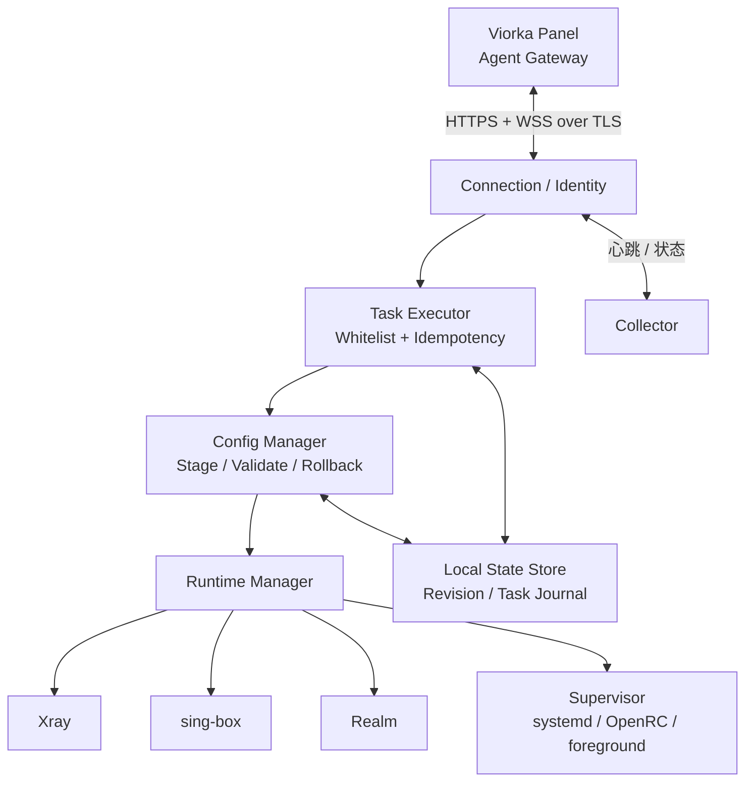

# Viorka Agent 架构（独立仓库）

> M0 当前状态：已实现注册、签名会话、WSS、重连/吊销和只读 node.inspect；完整运行说明与未完成验收见 [GETTING_STARTED.md](GETTING_STARTED.md)。
> Agent 是一个独立产品/仓库，设计目标是 **轻量、可恢复、安全执行、受限 NAT 环境可运行**。基础连接和只读检查已实现，下面涉及引擎的控制循环仍是目标。

## 1. 组件

Agent 不转发用户的代理业务流量；由 Xray、sing-box、Realm 承担数据平面。远程 Panel 断线时，Agent 不停止已有代理进程。

## 2. 模块边界

| 模块 | 职责 | 当前脚手架 |
|---|---|---|
| `connection` | 证书校验、注册会话、WSS、版本协商、重连与背压 | M0 已实现 |
| `collector` | OS/CPU/内存/磁盘/网络与引擎资产采集 | 基础 GOOS/GOARCH 已实现 |
| `executor` | 操作白名单、参数验证、重试、幂等、超时 | 仅 node.inspect 已实现 |
| `runtime` | 引擎生命周期统一接口 | 接口已定义，适配器未实现 |
| `config` | 本地启动配置、配置 staging、原子发布和回滚 | 仅本地 JSON 校验已实现 |
| `supervisor` | systemd/OpenRC/无 init 进程控制 | 仅文档占位 |
| `state` | 身份与密钥、上次 Revision、本地任务 Journal | 身份与检查日志已实现，Revision 留待 M2 |
| `updater` | 带签名/哈希的 Agent 更新、回滚 | 仅文档占位 |

## 3. 建议执行循环

1. 读取严格校验的本地 Bootstrap 配置，恢复受限权限密钥和最后成功状态。
2. 连接 Panel HTTPS Session，身份 challenge，通过 WSS 验证能力并建立单连接。
3. 并发启动：心跳、指标采集、任务接收；写入 WebSocket 时由单 writer 队列串行发送。
4. 对每个任务做鉴权/能力/参数/幂等/Revision/超时检查，然后才开始本地副作用。
5. 在临时目录生成和校验配置，受控切换服务，健康确认后持久化观察到的 Revision。
6. 断线不停止代理服务，保留有界本地日志，退避重连；重连时双向对账。

## 4. 轻量资源基线

- 单 Go 静态二进制，尽量 `CGO_ENABLED=0`，避免目标服务器 GLIBC 不匹配。
- `linux/amd64`、`linux/arm64` 首批支持；Alpine/musl 无需绑定发行版 glibc。
- 长期仅 **一条出站 WSS TCP**，适应 TCP 连接数可能很小的 NAT VPS。
- Agent 控制/指标消息大小有上限，节点 CPU 高负载时可降低上报频率。
- 不强制 Docker，不强制 systemd，不要求 UDP/QUIC。
- 本地数据目录可配置；日志限量轮转，避免消耗小盘空间。

> 资源消耗目标应经过真实空载/负载基准测试后才写入 README，不预先承诺某个 MB 数。

## 5. 运行/进程管理

| 系统 | 建议机制 |
|---|---|
| Debian/Ubuntu | systemd 管理 Agent，代理引擎可单独 Unit；不允许任意 unit 名称 |
| Alpine | OpenRC `supervise-daemon` 或受控服务模板 |
| Container / 无 init | foreground + 外部 supervisor（s6/supervisord） |
| 权限不足的 NAT VPS | 提供只读观测/无特权功能；需要 root 的引擎安装明确提示不可用 |

必须支持 Agent **卸载不删除代理配置** 的默认行为；卸载组件、停止服务、移除自管代理文件、删除用户数据应当是不同的明确操作。

## 6. 保活与离线

- Agent 与 Panel 断开不影响已运行的 Xray/sing-box/Realm。
- Gateway 根据心跳和时间标记离线，Agent 无法自行控制 Panel 在线判断。
- 重连报告 Agent 版本、协议能力、进程健康、Observed Revision 和最近 task receipt。
- 允许 Panel 判断是否需要重新发布，避免一重连就无条件覆盖本地所有配置。

## 7. 不得实现为通用 Shell

任务是类型化结构：`engine.install`、`engine.status`、`proxy.apply`、`proxy.rollback`、`port.inspect` 等。每个任务独立验证参数、允许路径、执行权限和超时。Agent 不接受浏览器上传的任意 shell 字符串；外部命令仅以固定可执行文件和明确定义的 argv 参数调用。

## 8. 依赖关系与未来演进

- `internal/app` 组装依赖，业务逻辑不要耦合到 `cmd/`。
- `internal/runtime` 提供 interface，具体适配器负责处理不同版本的启动/校验命令。
- `protocol/v1` 类型由 Panel Schema 生成，生成文件标注源摘要，发布 tag 尚待固定。
- `internal/state` 初期可使用文件/受控嵌入数据存储，任务日志有容量限制和原子写入要求。

详见 [RUNTIMES.md](RUNTIMES.md) 和 [ENROLLMENT.md](ENROLLMENT.md)。
